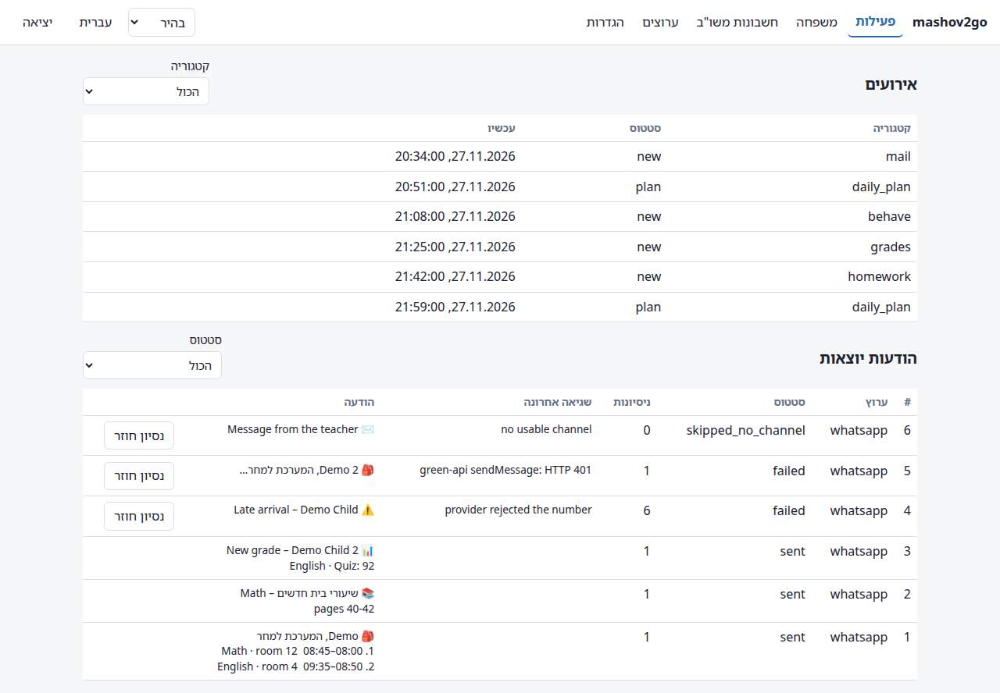
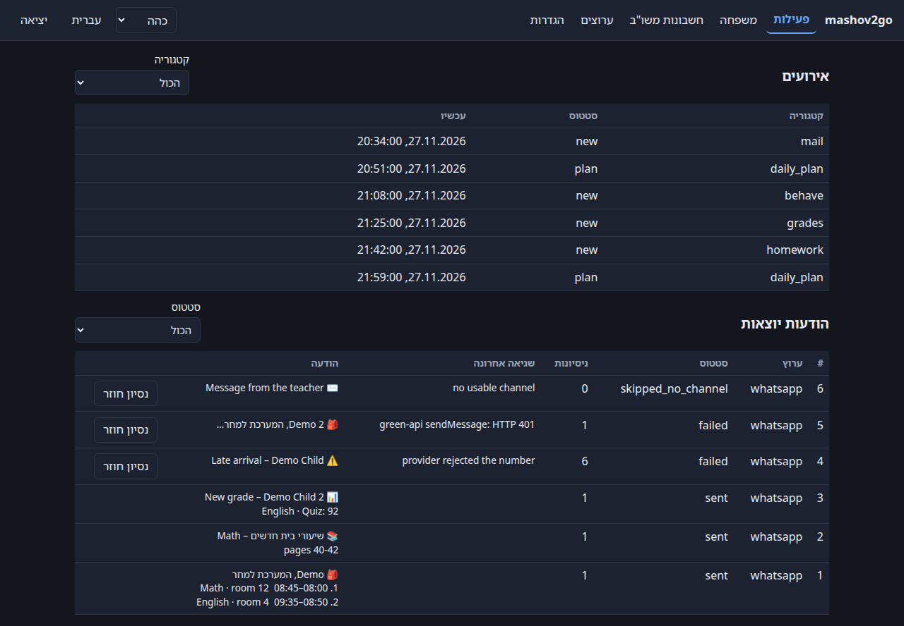
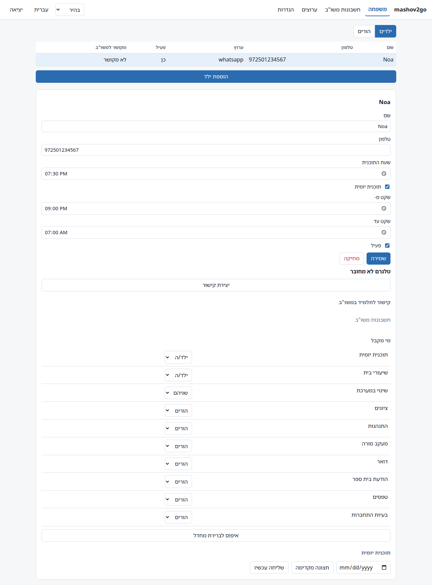
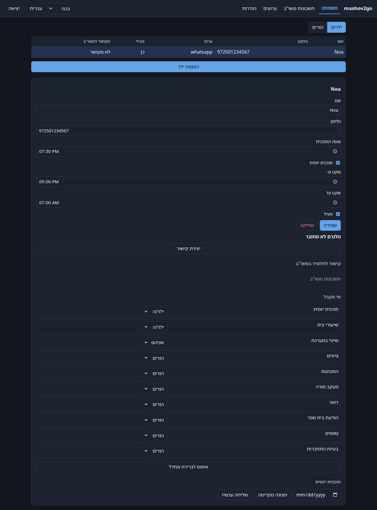
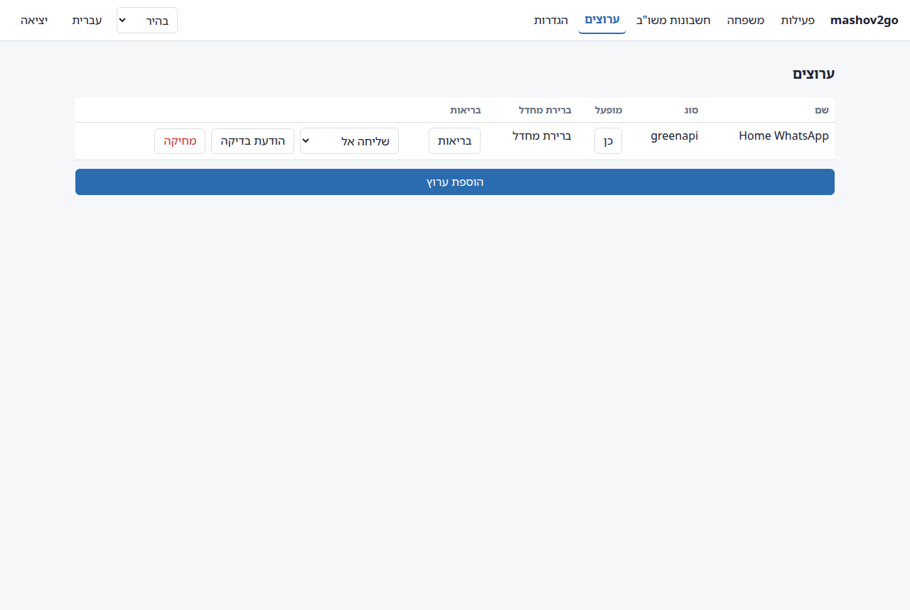
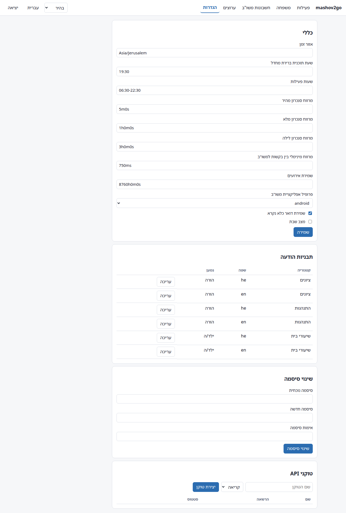

# mashov2go

mashov2go is a self-hosted bridge for Mashov (משו"ב), the Israeli school
parent portal. It signs in with a parent's own Mashov account, reads each
child's school data, and sends the family the daily plan and the updates they
need on WhatsApp or Telegram. It also serves an admin web UI and a REST API on
your LAN.

> **Disclaimer.** Mashov has no public API. This project talks to the same
> endpoints the official Android app uses, for personal use with your own
> account. It is not affiliated with Mashov. It only reads from Mashov.

[](LICENSE)

## Screenshots

| Activity (light) | Activity (dark) |
|---|---|
|  |  |

| Family (light) | Family (dark) |
|---|---|
|  |  |

| Channels (light) | Settings (light) |
|---|---|
|  |  |

The screenshots use demo data (fictional names and messages). The sign-in
screen is in `assets/screenshots/login-light.png`.

## What it does

- **Reads Mashov, read-only.** Signs in with a parent login (a device-pass is
  kept when Mashov issues one), lists the children a login can see, and reads
  each child's weekly timetable, timetable changes, bell times, holidays,
  homework, grades and behaviour records. A notification feed is polled during
  active hours, so new homework, grades and behaviour records reach the family
  between daily plans.
- **Daily plan.** Each evening (default 19:30, per child) it builds tomorrow's
  plan from the timetable, changes, bells and holidays. Holidays and days with
  no lessons are skipped. A change made after the plan was sent goes out as one
  update. The plan is fetched 15 minutes before it is sent.
- **Who gets what.** Each child has a recipient for each message category:
  the child, the parents, both, or off. A parent can mute a category for one
  child. Messages in quiet hours are held until the quiet period ends.
- **Channels.** WhatsApp through [Green-API](https://green-api.com) or
  OpenWA (a default channel plus per-member overrides), and Telegram through your own bot. Telegram members
  bind with a one-time link that expires after 24 hours.
- **Delivery.** Messages go through a queue with retries (30 s, 2 min, 10 min,
  1 h; six attempts at most). A permanent provider error fails at once, and an
  optional fallback channel is tried once. Failed and skipped deliveries can be
  retried from the UI or the API.
- **Admin UI and REST API.** A Hebrew right-to-left UI (English available),
  with light and dark themes. The API is documented in OpenAPI.
- **Operations.** Prometheus counters at `/metrics` (needs a read-scope API
  token), a health check at `/healthz`, and a single static binary (no CGO)
  with a container image.

### Not built yet

- Telegram commands other than `/מחר` (or `/tomorrow`), which a child's chat
  can use to get tomorrow's plan. Daily digests are not built.
- Class notes (maakav), teacher mail, forms and consents. Their Mashov response
  shapes are not yet confirmed from live traffic.
- Behaviour codes are shown with the school's own wording. Translating the
  codes themselves needs the app's strings.
- WhatsApp Web (whatsmeow). Only Green-API and OpenWA are implemented.
- A QR code for Telegram links. The link is shown as text.

## Requirements

- A Mashov parent account for each school (one login can see all its children).
- A WhatsApp provider: a Green-API instance, or an OpenWA gateway session. A
  Telegram bot is optional.
- To build from source: Go 1.26 and, for the UI, Node.js 24.
- To run in a container: Docker.
- A 32-byte master key, base64-encoded (see Configuration).

## Installation

### Container image

The image is not published yet, so build it locally:

```sh
docker build --build-arg VERSION=dev -t mashov2go .
docker run -d --name mashov2go -p 8080:8080 \
  -e MASHOV2GO_MASTER_KEY="$(openssl rand -base64 32)" \
  -e MASHOV2GO_ADMIN_PASSWORD='choose-a-long-password' \
  -v mashov2go-data:/data \
  mashov2go
```

The image runs as a non-root user (65532) from an empty base, and keeps its
data in `/data`.

### From source

```sh
cd web && npm ci && npm run build && cd ..   # builds the UI into internal/webui/dist
go build -o mashov2go ./cmd/mashov2go
./mashov2go run --data ./data
```

Without the UI build, the binary still runs. The root page then returns
"the UI is not built", and the API works.

## Configuration

Settings are read from flags first, then environment variables, then built-in
defaults. Settings that change how the service behaves (plan times, intervals,
timezone, retention) live in the database and are edited in the UI or with
`PATCH /api/v1/settings/general`, so they need no restart.

| Flag | Environment variable | Default | Description |
|---|---|---|---|
| `--data` | `MASHOV2GO_DATA_DIR` | `/data` | Directory holding `mashov2go.db` |
| `--listen` | `MASHOV2GO_LISTEN` | `:8080` | Address for the UI, API, `/healthz` and `/metrics` |
| `--insecure-cookies` | `MASHOV2GO_INSECURE_COOKIES` | off | Send session cookies without `Secure`, for plain-HTTP LAN access |
| — | `MASHOV2GO_MASTER_KEY` | — | **Required.** Base64 of 32 random bytes. Seals Mashov credentials and channel secrets |
| — | `MASHOV2GO_MASTER_KEY_FILE` | — | Path to a file holding the master key (used when `MASHOV2GO_MASTER_KEY` is empty) |
| — | `MASHOV2GO_ADMIN_PASSWORD` | — | Sets the admin password on first run, if none exists. At least 12 bytes |
| — | `MASHOV2GO_TRUSTED_PROXIES` | — | Comma-separated addresses or CIDRs whose `X-Forwarded-For` is trusted for login rate limiting |
| — | `MASHOV2GO_MASHOV_PASSWORD` | — | Password for the `mashov` CLI commands only (otherwise prompted) |

Keep the master key safe. Without it the stored Mashov credentials and channel
secrets cannot be opened.

## Usage

```sh
mashov2go --version
mashov2go run [--data DIR] [--listen ADDR] [--insecure-cookies]

# Live checks against Mashov (read-only, output is redacted)
mashov2go mashov schools [--q TEXT]
mashov2go mashov login  --semel N --year Y --username U [--profile android|web]
mashov2go mashov plan   --semel N --year Y --username U [--child INDEX] [--date YYYY-MM-DD]
mashov2go mashov get    --semel N --year Y --username U <path>
```

`run` serves the REST API and runs the background jobs (the daily plan, the
notification poll, the child data sync, the Telegram bind poller, the outbox,
and the expired-session cleanup) until it is stopped.

## Setting up

1. Start the service and open the UI. Set the admin password, unless you set
   `MASHOV2GO_ADMIN_PASSWORD`.
2. **Mashov accounts:** add a parent login. The service signs in once to check
   it, then lists the children that login can see.
3. **Family:** add the children and parents, with phone numbers. Link each child
   to a Mashov student.
4. **Channels:** add a WhatsApp channel (Green-API or OpenWA) and make it the
   default. Optionally add a Telegram bot.
5. For Telegram, create a bind link for each member and have them open it on
   their phone and press Start.
6. Check the recipients for each child, then use **Send now** on the plan to
   test it.

## API

The REST API is under `/api/v1`. The full description is at `/api/docs`, and
the OpenAPI document is at `/api/openapi.json`.

- Browser sessions sign in with `POST /api/v1/auth/login` and use the
  `m2g_session` cookie. State-changing requests send the session's CSRF token in
  `X-CSRF-Token`.
- Scripts use an API token as `Authorization: Bearer <token>`. Tokens have
  `read` or `admin` scope and are shown once when created.
- Errors are RFC 7807 problem documents.

## Security

- **Secrets at rest.** Mashov passwords, device passes and channel configuration
  are sealed with AES-256-GCM under the master key. Each value is bound to its
  row, so a sealed value cannot be moved to another row.
- **Tokens.** Session and API tokens are random, and only their SHA-256 hashes
  are stored. Bind tokens are stored the same way and work once.
- **Login.** The admin password is bcrypt-hashed. Failed logins are rate-limited
  per client address (5 per 15 minutes). Changing the password signs out the
  other sessions.
- **Cookies.** Session cookies are `HttpOnly`, `SameSite=Strict`, and `Secure`
  by default. Use `--insecure-cookies` only for plain-HTTP access on a trusted
  LAN. Browsers drop `Secure` cookies over `http://`.
- **Outbound.** Mashov is reached over HTTPS only (loopback is allowed for
  tests), and redirects to another origin are refused. Channel endpoints must
  use HTTPS too, and credentials are never placed in error messages.
- **Personal data.** Phone numbers and names are not written to logs. Message
  text, including homework, is stored in plaintext in the `deliveries` table
  (`body`), and event data in `events.data`. Protect the data directory
  accordingly.
- **Network.** The admin UI and API have no TLS of their own. Run them on a
  trusted network, or behind a TLS proxy such as a tunnel, and set
  `MASHOV2GO_TRUSTED_PROXIES` to that proxy.
- **Setup window.** Until the admin password is set, anyone who can reach the
  service can set it. Set `MASHOV2GO_ADMIN_PASSWORD` on the first start, or
  complete setup straight after the service starts.

## Development

```sh
go test -race ./...     # Go tests (temporary SQLite databases and httptest fakes; no network)
go vet ./...
cd web && npm ci && npm run build   # type-checks and builds the UI
cd web && npm run dev               # UI dev server, proxying /api to :8080
```

### Layout

```
cmd/mashov2go/        command-line entry point (run, mashov)
internal/api/         REST API, auth middleware, OpenAPI document and docs page
internal/auth/        bcrypt passwords, token hashing, login rate limiter
internal/connector/   Green-API, OpenWA and Telegram clients
internal/crypto/      AES-256-GCM sealing of secrets
internal/family/      members, validation, phone normalisation
internal/mashov/      the Mashov client (login, timetable, homework and more)
internal/mashovsource/ per-account Mashov sessions for the plan and child pages
internal/metrics/     Prometheus counters
internal/outbox/      delivery queue, retries and fallback
internal/planjob/     daily plan: prefetch, build, route, late-change updates
internal/planner/     plan timing and change decisions
internal/routing/     recipient and quiet-hours routing
internal/schedule/    lessons, changes, holidays and week numbers
internal/settings/    live settings with validation and change notifications
internal/store/       SQLite schema (embedded migrations) and queries
internal/telegrambind/ turns /start messages into chat bindings
internal/webui/       the embedded admin UI
web/                  the admin UI source (React, TypeScript, Vite)
```

## Contributing

Issues and pull requests are welcome. Keep changes small and tested, run the
checks above, and do not commit secrets or personal data (including screenshots
of real children).

## License

Apache License 2.0. See [LICENSE](LICENSE).
